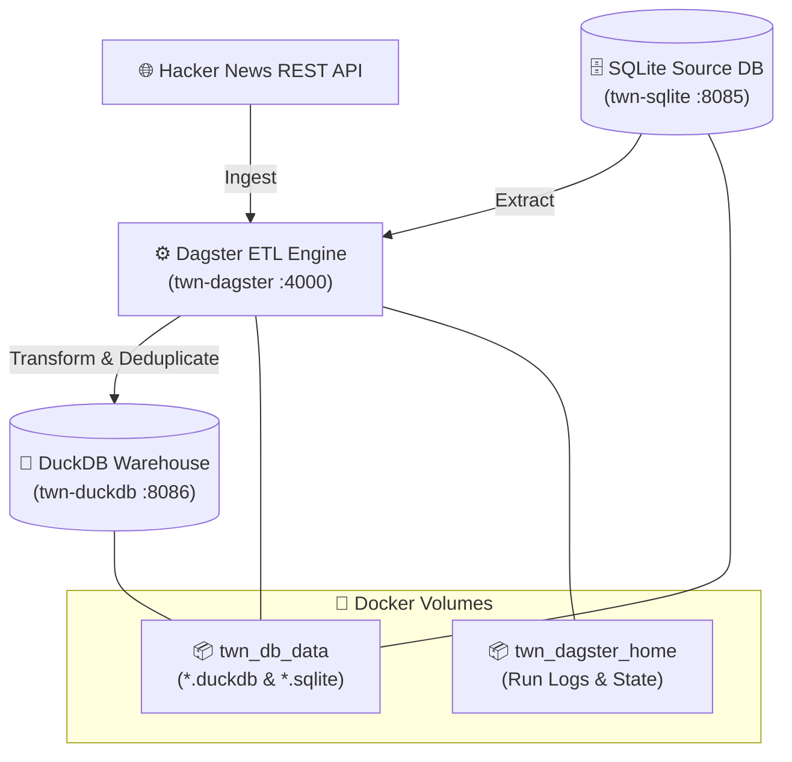

# 🚀 Tech World News Dagster ETL Pipeline

A modern, production-grade Data Engineering ETL pipeline orchestrated with **Dagster**, powered by **DuckDB** (as the analytical columnar data warehouse) and **SQLite** (as the relational transactional source database).

Everything is containerized using **Docker Compose** with dedicated database services, persistent volumes, and custom non-default ports to avoid port conflicts.

---

## 🏗️ Architecture Overview



---

## ✨ Features

- **DuckDB & SQLite Architecture**: High-performance analytical querying with DuckDB and transactional source ingestion with SQLite. Zero external database dependencies (No PostgreSQL required).
- **Dedicated Containerized Services**:
  - `twn-dagster`: Dagster Webserver and daemon orchestrator.
  - `twn-sqlite`: SQLite engine with web management interface.
  - `twn-duckdb`: DuckDB analytical database engine.
- **Custom Non-Default Ports**: Configured with custom ports (`4000`, `8085`, `8086`) so it never clashes with existing local services.
- **Full Data Persistence**: Named volumes (`twn_db_data` and `twn_dagster_home`) guarantee that all database records, run histories, and schedules persist across restarts and rebuilds.
- **Live Code Mount**: Edit pipeline definitions locally, and changes reload instantly without rebuilding containers.

---

## 🖥️ Live Service Endpoints

Once your containers are running, access the web services in your browser:

| Service | Container Name | URL / Port | Description |
| :--- | :--- | :--- | :--- |
| **Dagster Web UI** | `twn-dagster` | [http://localhost:4000](http://localhost:4000) | Pipeline graph, asset catalog, runs, and schedule monitoring |
| **SQLite Web GUI** | `twn-sqlite` | [http://localhost:8085](http://localhost:8085) | Visual table browser and SQL query runner for SQLite |
| **DuckDB Service** | `twn-duckdb` | `localhost:8086` | Dedicated DuckDB analytical warehouse environment |

---

## ⚡ Quick Start Guide

### 1. Prerequisites
- [Docker Desktop](https://www.docker.com/products/docker-desktop/) installed and running.

### 2. Start the Pipeline

Clone the repo and run:

```bash
# Build and start all services in detached mode
docker compose up -d --build

# Verify that all containers are healthy and running
docker compose ps
```

Open **[http://localhost:4000](http://localhost:4000)** in your browser to access the Dagster UI.

---

## 🛠️ Complete Docker Command Reference

### Starting, Stopping & Rebuilding

```bash
# Start all containers in the background
docker compose up -d

# Rebuild containers after modifying Dockerfile or requirements.txt
docker compose up -d --build

# Stop running containers (data remains safe in volumes)
docker compose stop

# Restart all services
docker compose restart

# Stop and remove containers and networks (data preserved in volumes)
docker compose down

# Full reset: Remove containers, networks, and persistent database volumes
docker compose down -v
```

### Checking Status & Logs

```bash
# View running containers, status, and mapped ports
docker compose ps

# Follow live logs from all containers
docker compose logs -f

# Follow logs only for the Dagster ETL pipeline
docker compose logs -f dagster-etl

# Follow logs only for the SQLite service
docker compose logs -f sqlite-db

# Follow logs only for the DuckDB service
docker compose logs -f duckdb
```

### Inspecting Databases via Terminal

#### 1. SQLite Database CLI
```bash
# Open interactive SQLite prompt inside the container
docker exec -it twn-sqlite sqlite3 /data/hackernews.sqlite

# Run a quick query directly from your host terminal
docker exec -it twn-sqlite sqlite3 /data/hackernews.sqlite "SELECT name FROM sqlite_master WHERE type='table';"
```

#### 2. DuckDB Database CLI
```bash
# Open interactive DuckDB prompt inside the container
docker exec -it twn-duckdb /duckdb /workspace/dagster_tutorial.duckdb

# Run a quick query directly from your host terminal
docker exec -it twn-duckdb /duckdb /workspace/dagster_tutorial.duckdb -c "SHOW TABLES;"
```

### Running Dagster Pipelines from Terminal

You can trigger Dagster jobs directly via CLI without opening the web browser:

```bash
# Execute a Dagster job inside the container
docker exec -it twn-dagster dagster job execute -m orchestration -j <job_name>

# List all loaded assets in the current repository
docker exec -it twn-dagster dagster asset list -m orchestration
```

---

## 📁 Repository Structure

```text
tech-world-news-dagster-etl-pipeline/
├── Dockerfile              # Python 3.10 slim image definition for Dagster
├── docker-compose.yml      # Multi-service setup (twn-dagster, twn-sqlite, twn-duckdb)
├── requirements.txt        # Python libraries (dagster, duckdb, pandas, sqlalchemy)
├── .gitignore              # Ignores runtime databases and cache files
├── .dockerignore           # Excludes git and local storage from Docker build
├── README.md               # Project documentation and command guide
└── dagster_home/           # Dagster instance settings and SQLite metadata storage
    └── dagster.yaml        # Storage and telemetry configuration
```

---

## 💾 Data Persistence Explained

Data persistence is managed via two Docker named volumes:

1. **`twn_db_data`**:
   - Mounted to `/opt/dagster/data` in `twn-dagster`
   - Mounted to `/data` in `twn-sqlite`
   - Mounted to `/workspace` in `twn-duckdb`
   - Keeps both `.duckdb` and `.sqlite` database files synchronized and persistent across all three containers.

2. **`twn_dagster_home`**:
   - Mounted to `/opt/dagster/dagster_home` in `twn-dagster`
   - Stores Dagster run history, event logs, and schedule state so runs are never lost when containers are recreated.

---

## 💡 Troubleshooting & FAQ

- **Port Conflict on 4000, 8085, or 8086?**
  - Change the host port mapping in [docker-compose.yml](file:///Users/mohammeddanish/Project/tech-world-news-dagster-etl-pipeline/docker-compose.yml) (e.g., `"4001:4000"` or `"8087:8085"`).
- **How to completely wipe all database records and start fresh?**
  - Run `docker compose down -v` followed by `docker compose up -d --build`.
- **Can I inspect database files on my host machine?**
  - Yes! You can copy the database files out of the volume anytime:
    ```bash
    docker cp twn-dagster:/opt/dagster/data ./local_backup_data
    ```